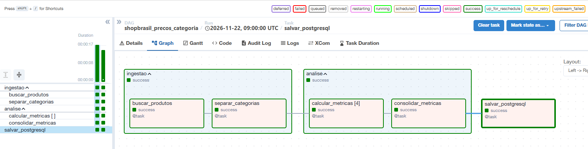
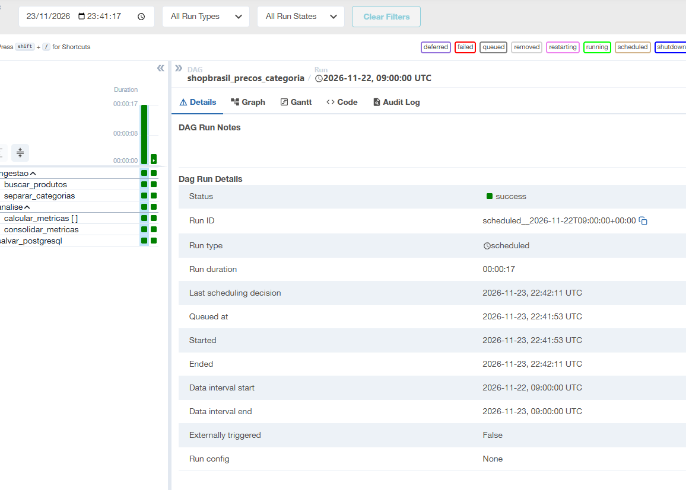
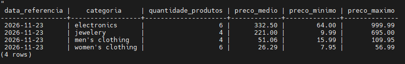
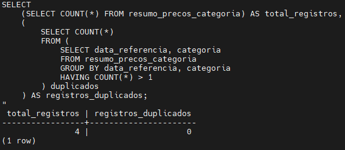

# ShopBrasil — Atividade 01 (Apache Airflow)

Projeto didatico para a disciplina **Orquestracao de Workflows**: consulta produtos da [FakeStore API](https://fakestoreapi.com/docs), calcula um resumo diario por categoria e salva os resultados em PostgreSQL.

## Escopo implementado

- TaskFlow API (`@dag` e `@task`) com XComs automaticos contendo apenas categoria/preco e resumos pequenos.
- DAG agendada **todos os dias as 06:00 de Brasilia** (`America/Sao_Paulo` com `pendulum`, `catchup=False`).
- Busca de produtos com `try/except + raise`, **3 retries**, backoff exponencial e callbacks de sucesso, retry e falha.
- **2 TaskGroups:** `ingestao` e `analise`.
- Categorias descobertas a partir da API; **Dynamic Task Mapping** com `.expand()` para calcular uma task por categoria.
- **Pool `ecommerce_pool` com 2 slots**, criado automaticamente no bootstrap do Docker Compose.
- Consolidacao de resultados (**fan-in**) e carga para PostgreSQL via `PostgresHook` e Connection `shopbrasil_db`.
- Gravacao **idempotente** via chave primaria (`data_referencia`, `categoria`) e `INSERT ... ON CONFLICT DO UPDATE`.
- Mensagens de alerta simuladas nos logs do Airflow (nenhum servico externo de notificacao).

Os itens opcionais (operador customizado e tabela extra de historico) nao foram implementados.

## Fluxo do pipeline

```text
[ingestao]
  buscar_produtos (FakeStore API, retries)
         |
  separar_categorias
         |
[analise]
  calcular_metricas.expand(...)  <- fan-out, no maximo 2 simultaneas (pool)
         |
  consolidar_metricas            <- fan-in
         |
  salvar_postgresql              <- UPSERT (sem duplicatas)
```

O processamento calcula `quantidade_produtos`, `preco_medio`, `preco_minimo` e `preco_maximo` por categoria. Novas categorias aparecem automaticamente na proxima coleta.

## Estrutura

```text
shopbrasil-airflow-atividade01/
├── dags/shopbrasil_precos.py  # DAG e logica do pipeline
├── sql/init.sql               # Tabela analitica com chave primaria
├── Dockerfile                 # Airflow 2.9.3 e PostgresHook
├── docker-compose.yml        # Airflow webserver, scheduler e 2 bancos
├── .env.example               # Modelo de configuracao local
└── README.md
```

## Executar com Docker Compose

### 1. Preparar o ambiente

Requisitos: Docker Engine, plugin Docker Compose e memoria disponivel para os containers do Airflow.

```bash
cp .env.example .env
nano .env  # ALTERE as 3 senhas antes de subir
mkdir -p logs
sudo chown -R 50000:0 logs
sudo chmod -R u+rwX,g+rwX logs
chmod 755 dags sql
chmod 644 dags/*.py sql/*.sql
```

> As senhas precisam ser alfanumericas neste exemplo simples, pois a senha do banco de metadados faz parte de uma URL de conexao. Nunca inclua o `.env` no repositorio.

### 2. Iniciar o projeto

```bash
docker compose config --quiet
docker compose up -d --build
docker compose ps -a
```

O `airflow-init` termina com codigo `0` apos criar as tabelas do Airflow, o usuario `admin`, a Connection `shopbrasil_db` e o pool `ecommerce_pool`. Os servicos `airflow-webserver` e `airflow-scheduler` continuam em execucao.

Se a inicializacao falhar, inspecione `docker compose logs airflow-init` antes de continuar.

### 3. Abrir a interface

A interface esta publicada **somente no localhost da maquina Docker**, na porta `8083`. Se o projeto estiver em uma VPS, abra um tunel SSH a partir de seu computador:

```bash
ssh -N -L 18083:127.0.0.1:8083 SEU_USUARIO@SEU_SERVIDOR
```

Acesse `http://localhost:18083` e faca login com usuario `admin` e a senha de `AIRFLOW_ADMIN_PASSWORD` do seu `.env`.

Para executar localmente no proprio host da instalacao, acesse `http://localhost:8083`.

### 4. Executar e verificar a DAG

Na interface, encontre `shopbrasil_precos_categoria`, ative a DAG e clique em **Trigger DAG** para testar manualmente. A execucao programada ocorre diariamente as 06:00 de Brasilia, desde que o scheduler esteja rodando.

Verifique o pool e a Connection sem expor senhas:

```bash
docker compose exec airflow-webserver airflow pools list
docker compose exec airflow-webserver airflow connections list --conn-id shopbrasil_db
docker compose exec airflow-scheduler airflow dags list-import-errors
```

Veja os registros gerados:

```bash
docker compose exec postgres-analytics psql -U analytics -d analytics -c \
  'SELECT data_referencia, categoria, quantidade_produtos, preco_medio, preco_minimo, preco_maximo FROM resumo_precos_categoria ORDER BY data_referencia DESC, categoria;'
```

Teste a idempotencia: na interface, limpe e reexecute **somente** `salvar_postgresql` da mesma DAG Run. Ela nao deve inserir novas linhas. Para comprovar:

```bash
docker compose exec postgres-analytics psql -U analytics -d analytics -c \
  'SELECT data_referencia, categoria, COUNT(*) FROM resumo_precos_categoria GROUP BY 1, 2 HAVING COUNT(*) > 1;'
```

A consulta deve retornar `0 rows` (e a propria chave primaria impede duplicatas).

## Observacoes

- Trata-se de um **laboratorio didatico**, nao de uma configuracao para producao.
- Nao expoe o PostgreSQL na internet nem publica o Airflow em `0.0.0.0`.
- Os dois bancos sao separados: um armazena metadados do Airflow, outro armazena os resumos de precos.
- O XCom transporta somente um catalogo reduzido (`categoria`, `preco`) e as metricas resumidas; nao transporta um DataFrame nem dados grandes.
- Os callbacks registram alertas **simulados**. Nao ha envio real de email ou Slack.
- Nao executar `docker compose down -v` se quiser preservar os dados.

## Referencias

- [FakeStore API](https://fakestoreapi.com/docs)
- [Apache Airflow 2.9.3 — Docker Compose](https://airflow.apache.org/docs/apache-airflow/2.9.3/howto/docker-compose/index.html)
- [Apache Airflow 2.9.3 — Dynamic Task Mapping](https://airflow.apache.org/docs/apache-airflow/2.9.3/authoring-and-scheduling/dynamic-task-mapping.html)

## Publicar no GitHub (entrega)

1. Crie um repositorio **publico** e **vazio** chamado `shopbrasil-airflow-atividade01` em <https://github.com/new>. Nao marque a opcao de adicionar README, pois este projeto ja contem um.
2. No terminal, na pasta `shopbrasil-airflow-atividade01`, execute:

```bash
git init
git add .
git commit -m "Atividade 01 - Airflow ShopBrasil"
git branch -M main
git remote add origin https://github.com/SEU_USUARIO/shopbrasil-airflow-atividade01.git
git push -u origin main
```

3. Verifique que o README e o `docker-compose.yml` aparecem no repositorio publico e **que o arquivo `.env` nao foi enviado**. Entregue o link `https://github.com/SEU_USUARIO/shopbrasil-airflow-atividade01`.

Se quiser executar o projeto na VPS depois da publicacao, faca `git clone` dentro de uma nova pasta em `/opt/labs-puc/orquestracao-workflows/` e siga os passos do Docker Compose. O projeto tem nome, volumes e porta de webserver proprios, para nao conflitar com o laboratorio anterior.


## Evidências de execução

O pipeline foi executado com sucesso no Apache Airflow, realizando a ingestão de produtos da FakeStore API, o processamento de métricas por categoria e a persistência dos resultados no PostgreSQL.

### 01 — Pipeline executado com sucesso

Visualização do fluxo de execução com os TaskGroups de ingestão e análise.



### 02 — Histórico da execução

Execução das tarefas com status de sucesso no Apache Airflow.



### 03 — Resultados no PostgreSQL

Métricas consolidadas por categoria, incluindo quantidade de produtos e preços médio, mínimo e máximo.



### 04 — Validação de idempotência

Verificação da ausência de registros duplicados por data e categoria após reexecução da etapa de persistência.



